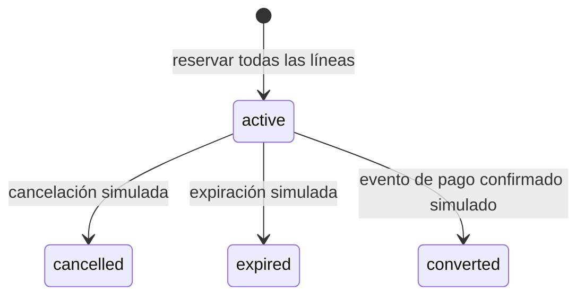

# F-02: Gestionar inventario — estado del frontend

Referencia: PR - TiendaRopa.xlsx, hoja Priorización de Requerimientos, SWR-06–10.
Ruta: `/admin/inventory`. Todos los datos y eventos son simulados en memoria;
recargar o salir restaura el ejemplo. No existe una sesión de administrador real.

| Requisito | Demostración implementada | Pendiente real |
| --- | --- | --- |
| SWR-06 | Existente, reservado y disponible por SKU y talla; disponible = existente − reservado | Consulta autorizada al servidor |
| SWR-07 | Ajuste entero no negativo, no inferior a reservado; motivo, anterior/nuevo, usuario demo y fecha en historial | Autorización administrativa y auditoría persistente |
| SWR-08 | Todas las líneas comprobadas antes de reservar; repetición sin duplicar | Transacción y concurrencia del backend |
| SWR-09 | Cancelación/expiración manuales liberan una sola vez, sin tocar existente | Eventos reales, política de vencimiento y efectos únicos en servidor |
| SWR-10 | Evento confirmado simulado convierte reserva activa en salida una sola vez | Autenticidad del pago, vigencia y transacción del backend |

## Estados del laboratorio

Reservar no descuenta existente. Cancelar o expirar solo resta reservado. Convertir
resta existente y reservado, dejando disponible igual que antes de la conversión.
Las reservas iniciales ajenas al pedido se conservan. Las repeticiones de un evento
ya aplicado no vuelven a afectar cantidades; los eventos incompatibles se rechazan.
No se establece una duración de reserva ni se infiere aprobación real de un clic.

## Organización

- `demo/inventoryDemo.ts`: artículos y modelo local por talla.
- `demo/adjustDemoInventory.ts`: validación y registro de ajuste.
- `demo/reserveDemoInventory.ts`: reserva de todas las líneas y pedidos ficticios.
- `demo/releaseDemoReservation.ts`: liberación por cancelación/expiración.
- `demo/convertDemoReservation.ts`: salida asociada al evento confirmado simulado.
- `InventoryPage`: aplica artículos e historial/reservas en un mismo estado React.
- `InventoryReservationPanel`: controles del laboratorio y mensajes accesibles.

Las funciones puras respecto a sus entradas devuelven copias; las fechas y los
identificadores son locales. No son contratos REST ni una implementación de backend.
Los tests de lógica verifican invariantes y repetición; `tests/inventory.spec.ts`
comprueba UI, errores, tabla, historial y axe en escritorio, tablet y móvil.

F-02 puede entregarse como **demostración frontend**, con la autorización por rol
y la integración explícitamente pendientes. El laboratorio es independiente de F-01.
